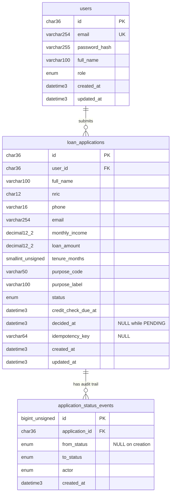

# Database schema

MySQL 9.7, InnoDB, `utf8mb4`. Schema changes only via TypeORM migrations
(`apps/api/src/database/migrations`, `synchronize: false`). Timestamps are `DATETIME(3)` stored in UTC.

## Tables

### `users`

| Column | Type | Null | Notes |
| --- | --- | --- | --- |
| `id` | CHAR(36) | no | PK, UUID generated by the app |
| `email` | VARCHAR(254) | no | Unique, stored lower-cased |
| `password_hash` | VARCHAR(255) | no | argon2id PHC string |
| `full_name` | VARCHAR(100) | no | |
| `role` | ENUM('CUSTOMER','ADMIN') | no | Default `CUSTOMER`; `ADMIN` only via the seed command |
| `created_at` / `updated_at` | DATETIME(3) | no | Default `CURRENT_TIMESTAMP(3)`; `updated_at` also `ON UPDATE` |

### `loan_applications`

| Column | Type | Null | Notes |
| --- | --- | --- | --- |
| `id` | CHAR(36) | no | PK, UUID generated by the app |
| `user_id` | CHAR(36) | no | FK `users.id`, `ON DELETE RESTRICT` |
| `full_name` | VARCHAR(100) | no | Applicant name as submitted |
| `nric` | CHAR(12) | no | Normalised 12 digits; masked in list views, never logged |
| `phone` | VARCHAR(16) | no | E.164, e.g. `+60123456789` |
| `email` | VARCHAR(254) | no | Contact email, lower-cased; may differ from the login email |
| `monthly_income` | DECIMAL(12,2) | no | RM |
| `loan_amount` | DECIMAL(12,2) | no | RM |
| `tenure_months` | SMALLINT UNSIGNED | no | |
| `purpose_code` | VARCHAR(50) | no | From the upstream purposes list |
| `purpose_label` | VARCHAR(100) | no | Label snapshot at submission; no FK because purposes live upstream |
| `status` | ENUM('PENDING','APPROVED','REJECTED') | no | Default `PENDING`; terminal once decided |
| `credit_check_due_at` | DATETIME(3) | no | Random 10 s - 5 min after submission, chosen at submit time |
| `decided_at` | DATETIME(3) | yes | NULL exactly while `PENDING` |
| `idempotency_key` | VARCHAR(64) | yes | Client `Idempotency-Key` header, scoped per user |
| `created_at` / `updated_at` | DATETIME(3) | no | As above |

### `application_status_events`

Append-only audit trail. A row is written on creation (`from_status` NULL, `to_status` PENDING, actor CUSTOMER)
and on each decision (actor SYSTEM).

| Column | Type | Null | Notes |
| --- | --- | --- | --- |
| `id` | BIGINT UNSIGNED | no | PK, auto-increment (returned as a string by mysql2) |
| `application_id` | CHAR(36) | no | FK `loan_applications.id`, `ON DELETE RESTRICT` |
| `from_status` | ENUM(status) | yes | NULL for the creation event |
| `to_status` | ENUM(status) | no | |
| `actor` | ENUM('CUSTOMER','SYSTEM','ADMIN') | no | Who caused the change |
| `created_at` | DATETIME(3) | no | |

## Indexes and the queries they serve

| Index | Columns | Query it serves |
| --- | --- | --- |
| `loan_applications.IDX_loan_applications_user_created` | `(user_id, created_at)` | Customer list: own rows, newest first, paginated; also the ownership check on detail |
| `loan_applications.IDX_loan_applications_status_created` | `(status, created_at)` | Admin list filtered by status, newest first |
| `loan_applications.IDX_loan_applications_created` | `(created_at)` | Admin list with no filter, newest first |
| `loan_applications.IDX_loan_applications_status_due` | `(status, credit_check_due_at)` | Credit-check scan: `WHERE status = 'PENDING' AND credit_check_due_at <= now` (boot re-enqueue and overdue recovery) |
| `loan_applications.UQ_loan_applications_user_idempotency` | `(user_id, idempotency_key)` unique | Idempotent submit: a repeated key from the same user hits the existing row. Multiple NULL keys are allowed |
| `users.UQ_users_email` | `(email)` unique | Login lookup and duplicate-registration check (`409`) |
| `application_status_events.IDX_status_events_application_created` | `(application_id, created_at)` | Audit trail of one application in order |

Primary keys cover lookups by id. The `user_id` foreign key is served by the leftmost column of the
`(user_id, created_at)` index.

## Constraints

- Foreign keys: `loan_applications.user_id -> users.id` and `application_status_events.application_id -> loan_applications.id`, both `ON DELETE RESTRICT`.
- CHECK constraints on `loan_applications` (enforced by MySQL 8.0.16+). The bounds come from `LOAN_LIMITS` in `libs/shared`, the same constant the DTOs use:
  - `CHK_loan_applications_loan_amount`: `loan_amount BETWEEN 1000 AND 200000`
  - `CHK_loan_applications_tenure`: `tenure_months BETWEEN 12 AND 84`
  - `CHK_loan_applications_income`: `monthly_income > 0 AND monthly_income <= 10000000`
  - `CHK_loan_applications_decided_at`: `(status = 'PENDING') = (decided_at IS NULL)`
- Changing a limit later needs a new migration that alters these CHECKs.

## Money

- Stored as `DECIMAL(12,2)`, never FLOAT/DOUBLE.
- mysql2 returns DECIMAL as a string, and the entity types it as `string`. In the API and the web app, amounts travel as strings matching `^\d{1,10}(\.\d{1,2})?$`.
- Range checks compare integer sen (`moneyToSen` in `libs/shared`), so there is no float error at boundaries such as 999.99 / 1000.00 / 200000.00 / 200000.01.
- Display as RM with 2 decimals (`formatMoney`).

## Not tables

- **Loan purposes**: fetched from an upstream (simulated core-banking) service and cached. Applications keep `purpose_code` and a `purpose_label` snapshot, with no FK.
- **Sessions**: stateless JWT in an httpOnly cookie; nothing is stored server-side.
- **`migrations`**: bookkeeping table managed by TypeORM.
- **Credit-check jobs**: BullMQ delayed jobs live in Redis. The `loan_applications` row is the source of truth (see PRD §7, D1).
